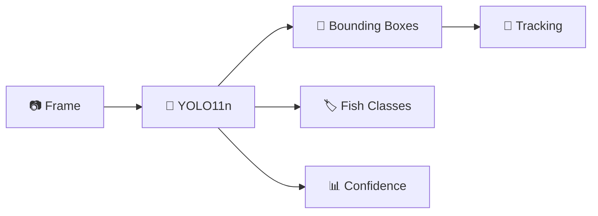
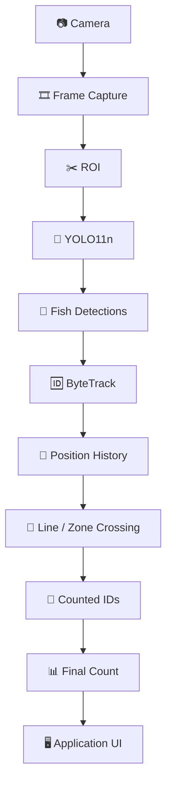

# 🐟 Fish Fry Counter Machine

<p align="center">

### AI-Powered Fish Detection, Tracking & Counting System

**Detect → Track → Assign IDs → Count → Monitor**

</p>

---

## 👋 What is this project?

**Fish Fry Counter Machine** is a computer-vision system designed to automatically detect, track, and count fish from images, videos, and live camera streams.

The project combines **YOLO11 object detection** with **ByteTrack-based object tracking** to identify individual fish and maintain unique tracking IDs while they move through the camera view.

The overall development workflow follows:

```text
Dataset Collection
        ↓
Multiple Dataset Integration
        ↓
Image Annotation with LabelImg
        ↓
YOLO Label Generation
        ↓
Class Consolidation
        ↓
Python Dataset Distribution
        ↓
YOLO11n Training
        ↓
Validation & Evaluation
        ↓
Video Detection
        ↓
Object Tracking
        ↓
Unique Fish Counting
        ↓
Live Camera Testing
        ↓
Mobile / Application Integration
```

The project is being developed toward a practical fish-counting solution that can eventually be connected to a dedicated application interface.

---

# 🐟 Supported Fish Classes

The current YOLO dataset configuration contains **16 fish categories**.

|  # | Fish Class     |
| -: | -------------- |
|  0 | Big Head Carp  |
|  1 | Black Rohu     |
|  2 | Catla          |
|  3 | Climbing Perch |
|  4 | Common Carp    |
|  5 | Glass Perchlet |
|  6 | Grass Carp     |
|  7 | Knifefish      |
|  8 | Mrigal         |
|  9 | Mudfish        |
| 10 | Nile Tilapia   |
| 11 | Pangasius      |
| 12 | Rohu           |
| 13 | Silver Carp    |
| 14 | Snakehead      |
| 15 | Tilapia        |

These classes are defined in the project's `dataset.yaml`.

---

# ⚡ Quick Overview

| Component           | Implementation               |
| ------------------- | ---------------------------- |
| Problem             | Fish detection and counting  |
| Task                | Multi-class object detection |
| Number of Classes   | 16                           |
| Annotation Tool     | LabelImg                     |
| Annotation Type     | Bounding Boxes               |
| Label Format        | YOLO                         |
| Detection Model     | YOLO11n                      |
| Tracking            | ByteTrack                    |
| Framework           | Ultralytics                  |
| Deep Learning       | PyTorch                      |
| Computer Vision     | OpenCV                       |
| Training Epochs     | 50                           |
| Training Image Size | 512 × 512                    |
| Training Batch Size | 4                            |
| GPU                 | CUDA device `0`              |
| Workers             | 2                            |
| Mixed Precision     | AMP enabled                  |
| Validation          | Enabled                      |
| Main Application    | Python/OpenCV                |
| Camera Testing      | Laptop + Phone/DroidCam      |
| UI Direction        | Figma + Flutter/React        |

---

# 🏗️ System Architecture

```mermaid
flowchart LR

    A["📚 Multiple Fish Datasets"]
    B["🔗 Dataset Combination"]
    C["🖼️ Individual Image Annotation"]
    D["🏷️ LabelImg"]
    E["📦 YOLO Labels"]
    F["🧹 Class Consolidation"]
    G["🐍 Python Dataset Split"]
    H["🚂 Train / Val / Test"]
    I["🧠 YOLO11n"]
    J["🎯 Fish Detection"]
    K["🔢 ByteTrack"]
    L["🆔 Unique Fish IDs"]
    M["📊 Fish Count"]
    N["📷 Live Camera / Video"]
    O["📱 Application UI"]

    A --> B
    B --> C
    C --> D
    D --> E
    E --> F
    F --> G
    G --> H
    H --> I
    I --> J
    J --> K
    K --> L
    L --> M

    N --> J
    M --> O
```



---

# 🔄 End-to-End Pipeline

The system is divided into several stages.

```text
                         DATA PREPARATION
                               │
                               ▼
              ┌─────────────────────────────┐
              │ Multiple Fish Datasets      │
              └──────────────┬──────────────┘
                             ↓
              ┌─────────────────────────────┐
              │ Combine / Consolidate Data  │
              └──────────────┬──────────────┘
                             ↓
              ┌─────────────────────────────┐
              │ LabelImg Annotation         │
              │ Bounding Boxes              │
              └──────────────┬──────────────┘
                             ↓
              ┌─────────────────────────────┐
              │ YOLO Annotation Files       │
              └──────────────┬──────────────┘
                             ↓
              ┌─────────────────────────────┐
              │ Class Normalization         │
              └──────────────┬──────────────┘
                             ↓
              ┌─────────────────────────────┐
              │ Python Dataset Split        │
              └──────────────┬──────────────┘
                             ↓
                  TRAIN / VALIDATION / TEST
                             │
                             ▼
                       YOLO11n TRAINING
                             │
                             ▼
                      FISH DETECTION
                             │
                             ▼
                       BYTETRACK
                             │
                             ▼
                     UNIQUE TRACK IDs
                             │
                             ▼
                      FISH COUNTING
                             │
                             ▼
                    CAMERA / APPLICATION
```

---

# 📚 Phase 1 — Environment Preparation

The project starts by preparing the Python environment and recording the installed dependencies.

The repository contains a `requirements.txt` file generated from the development environment.

The main computer-vision and ML dependencies include:

```text
Ultralytics
PyTorch
TorchVision
OpenCV
NumPy
Pandas
```

The project currently records versions such as:

```text
ultralytics==8.3.235
torch==2.9.1
torchvision==0.24.1
opencv-python==4.12.0.88
numpy==2.2.4
```

> Dependency versions can change as the project evolves. For reproducible deployment, the committed `requirements.txt` should be treated as the authoritative dependency specification for that repository snapshot.

---

# 🗂️ Phase 2 — Dataset Collection & Combination

The training data was not treated as a single-source dataset.

Multiple fish datasets were collected and combined to create a broader training dataset containing the required fish categories.

The general process was:

```text
Dataset 1
   +
Dataset 2
   +
Dataset 3
   +
Additional Images
        │
        ▼
Combined Fish Dataset
```

This approach was used to increase the diversity of:

* Fish appearance
* Fish orientation
* Fish size
* Background conditions
* Image quality
* Lighting conditions
* Species representation

### Why combine datasets?

A single dataset may have limited variation.

Combining multiple sources can provide more visual diversity, but it also introduces additional challenges:

* Different image resolutions
* Different annotation conventions
* Different backgrounds
* Different class naming
* Different image distributions
* Possible duplicate images
* Possible domain differences

Therefore, dataset normalization and annotation verification are important before training.

---

# 🏷️ Phase 3 — Manual Image Annotation with LabelImg

Each image used for object detection was manually inspected and annotated using **LabelImg**.

The annotation process consisted of:

```text
Image
  ↓
Open in LabelImg
  ↓
Identify Fish
  ↓
Draw Bounding Box
  ↓
Assign Fish Class
  ↓
Save Annotation
```

Each fish instance receives its own bounding box.

For example:

```text
             Fish
        ┌──────────────┐
        │              │
        │    🐟        │
        │              │
        └──────────────┘
              ↓
        YOLO Annotation
```

The purpose of this stage is to provide the model with:

1. **Where the fish is located**
2. **Which fish class it belongs to**

---

# 📐 YOLO Annotation Format

The generated annotation follows the YOLO-style object-detection representation.

Conceptually:

```text
class_id center_x center_y width height
```

The bounding-box coordinates are normalized relative to the image dimensions.

Example:

```text
10 0.512 0.437 0.284 0.192
```

Where:

```text
10      → class ID
0.512   → normalized center X
0.437   → normalized center Y
0.284   → normalized width
0.192   → normalized height
```

Each image can contain multiple annotation rows when multiple fish are present.

---

# 🧹 Phase 4 — Class Consolidation

Because multiple datasets were combined, class labels needed to be standardized.

The project contains a utility named:

```text
Class_reset_from_files.py
```

This utility can modify YOLO annotation class IDs.

This was useful when source datasets used different class numbering conventions.

The resulting dataset uses one consistent class-index mapping:

```text
0  → Big Head Carp
1  → Black Rohu
2  → Catla
...
15 → Tilapia
```

### Why class normalization matters

If two datasets use different class IDs for the same fish species, directly combining their labels can corrupt the training data.

Therefore:

```text
Source Dataset A
       +
Source Dataset B
       ↓
Different Class IDs
       ↓
Normalization
       ↓
Unified Class Mapping
       ↓
Training Dataset
```

---

# 🐍 Phase 5 — Dataset Distribution with Python

After dataset preparation, Python was used to distribute the data into separate subsets.

The project contains:

```text
distributed.py
```

The script creates:

```text
train/
val/
test/
```

and distributes files according to configured ratios.

The current script uses:

```python
train_ratio = 0.78
val_ratio = 0.11
test_ratio = 0.11
```

The process is:

```text
Complete Dataset
       │
       ▼
    Shuffle
       │
       ▼
 ┌─────┼─────────┐
 ↓     ↓         ↓
Train  Val      Test
78%    11%      11%
```

The files are shuffled before splitting to reduce ordering bias.

The script copies files into the resulting split directories rather than deleting the original source files.

---

# 📁 Dataset Structure

The YOLO training dataset follows the standard image/label organization.

```text
dataset/
│
├── images/
│   ├── train/
│   └── val/
│
├── labels/
│   ├── train/
│   └── val/
│
└── dataset.yaml
```

The current `dataset.yaml` defines:

```yaml
nc: 16
```

and the 16 class names.

---

# ⚙️ Dataset Configuration

The project uses a YOLO dataset configuration similar to:

```yaml
train: /path/to/dataset/images/train/
val: /path/to/dataset/images/val/

nc: 16

names:
  - Big Head Carp
  - Black Rohu
  - Catla
  - Climbing Perch
  - Common Carp
  - Glass Perchlet
  - Grass Carp
  - Knifefish
  - Mrigal
  - Mudfish
  - Nile Tilapia
  - Pangasius
  - Rohu
  - Silver Carp
  - Snakehead
  - Tilapia
```

> Dataset paths are machine-specific in the current training artifact. They should be changed to repository-relative or deployment-specific paths before distributing the project to another machine.

---

# 🧠 Phase 6 — YOLO11n Model Training

The project uses:

```text
YOLO11n
```

as the object-detection model.

The model is initialized from:

```text
yolo11n.pt
```

and trained on the custom 16-class fish dataset.

---

# 🎯 Why YOLO11n?

The `n` variant is the lightweight version of the YOLO11 model family.

A lightweight detector is useful for this project because the intended system includes:

* Live camera inference
* Laptop testing
* Potential mobile integration
* Real-time processing requirements
* Limited GPU resources

The smaller model reduces computational requirements compared with larger model variants.

However, a smaller model can also provide a different accuracy/speed trade-off compared with larger models.

---

# 🔧 Training Configuration

The recorded training run used:

| Parameter       |     Value |
| --------------- | --------: |
| Model           |   YOLO11n |
| Task            | Detection |
| Epochs          |        50 |
| Image Size      |       512 |
| Batch Size      |         4 |
| Device          |   GPU `0` |
| Workers         |         2 |
| AMP             |   Enabled |
| Pretrained      |       Yes |
| Optimizer       |      Auto |
| Validation      |   Enabled |
| Deterministic   |       Yes |
| Seed            |         0 |
| Mosaic          |       1.0 |
| Mixup           |       0.0 |
| Copy Paste      |       0.0 |
| Horizontal Flip |       0.5 |
| HSV Hue         |     0.015 |
| HSV Saturation  |       0.7 |
| HSV Value       |       0.4 |
| Translation     |       0.1 |
| Scale           |       0.5 |
| Warmup Epochs   |         3 |
| Initial LR      |      0.01 |
| Weight Decay    |    0.0005 |

These values come from the recorded `runs/detect/train6/args.yaml` training configuration.

---

# 💻 GPU-Aware Training

The training configuration was selected with limited GPU memory in mind.

The training setup uses:

```text
Batch Size = 4
Image Size = 512
AMP = True
Device = 0
Workers = 2
```

The training notebook explicitly used a smaller image size and batch size to accommodate a 4 GB GPU.

This is an important engineering trade-off:

```text
Higher Resolution
       ↓
Potentially better small-object information
       ↓
Higher VRAM requirement

Smaller Resolution
       ↓
Lower computational requirement
       ↓
Potentially faster inference
```

---

# 📊 Training Results

The repository contains the actual training artifacts under:

```text
runs/detect/train6/
```

including:

```text
results.csv
results.png
confusion_matrix.png
confusion_matrix_normalized.png
BoxP_curve.png
BoxR_curve.png
BoxF1_curve.png
BoxPR_curve.png
```

The final recorded epoch contains approximately:

| Metric    | Final Recorded Value |
| --------- | -------------------: |
| Precision |               0.9612 |
| Recall    |               0.9615 |
| mAP@50    |               0.9782 |
| mAP@50-95 |               0.8250 |

These values correspond to the final recorded training epoch in `results.csv`.

### Important

These are **validation detection metrics**, not a generic "accuracy" score.

Object detection evaluates both:

```text
Classification
+
Localization
```

Therefore metrics such as:

* Precision
* Recall
* mAP@50
* mAP@50-95

are more informative for this task.

---

# 📈 Evaluation Artifacts

The training run automatically generated visual evaluation artifacts.

### Precision Curve

```text
BoxP_curve.png
```

Used to inspect precision behavior across confidence thresholds.

### Recall Curve

```text
BoxR_curve.png
```

Used to inspect detection recall.

### F1 Curve

```text
BoxF1_curve.png
```

Shows the relationship between precision and recall.

### Precision-Recall Curve

```text
BoxPR_curve.png
```

Provides a broader view of detector performance across confidence thresholds.

### Confusion Matrix

```text
confusion_matrix.png
```

Useful for understanding confusion between fish classes.

### Normalized Confusion Matrix

```text
confusion_matrix_normalized.png
```

Provides normalized class-level confusion information.

---

# 🧪 Training Visualization

The training directory also contains sample visualizations:

```text
train_batch0.jpg
train_batch1.jpg
train_batch2.jpg
```

and later training samples:

```text
train_batch59520.jpg
train_batch59521.jpg
train_batch59522.jpg
```

Validation visualizations include:

```text
val_batch0_labels.jpg
val_batch0_pred.jpg

val_batch1_labels.jpg
val_batch1_pred.jpg

val_batch2_labels.jpg
val_batch2_pred.jpg
```

These artifacts are useful for checking whether the detector is learning the expected fish locations and classes.

---

# 🧠 Phase 7 — Detection Pipeline

During inference, the trained YOLO model receives an image or video frame.



The detector provides:

```text
Bounding Box
Class
Confidence
```

These detections are then passed to the tracking stage.

---

# 🆔 Phase 8 — Fish Tracking with ByteTrack

Detection alone identifies fish independently in each frame.

For counting fish across a video, the system needs to determine whether a fish detected in the current frame is the same fish detected previously.

This is where tracking is introduced.

The project uses:

```text
ByteTrack
```

through Ultralytics tracking.

Conceptually:

```text
Frame 1
Fish → ID 1
Fish → ID 2

        ↓

Frame 2
Fish → ID 1
Fish → ID 2
Fish → ID 3

        ↓

Frame 3
Fish → ID 1
Fish → ID 2
Fish → ID 3
```

The tracker attempts to maintain identity across frames.

---

# 🔢 Phase 9 — Unique Fish Counting

The tracking implementation maintains a Python set:

```python
counted_ids = set()
```

Whenever a new tracking ID is observed:

```python
if track_id not in counted_ids:
    counted_ids.add(track_id)
```

The total count is then:

```python
len(counted_ids)
```

This prevents the same tracked fish from being counted repeatedly in every frame.

---

# 🎥 Video Processing

The current tracking implementation uses:

```python
model.track(
    frame,
    persist=True,
    tracker="bytetrack.yaml",
    conf=0.15,
    iou=0.3,
    imgsz=640
)
```

The important inference settings are:

| Parameter  | Current Value | Purpose                      |
| ---------- | ------------: | ---------------------------- |
| `persist`  |        `True` | Maintain tracking state      |
| Tracker    |     ByteTrack | Track fish IDs               |
| Confidence |        `0.15` | Detect lower-confidence fish |
| IoU        |         `0.3` | Detection overlap threshold  |
| Image Size |         `640` | Inference resolution         |

The lower confidence threshold was selected in the current implementation to attempt to retain smaller or visually difficult fish in crowded scenes.

This can increase recall, but it may also increase false positives.

---

# 🖼️ Detection Visualization

The current tracking implementation draws:

```text
Bounding Box
+
Fish ID
+
Total Fish Count
```

Example conceptual output:

```text
┌─────────────────────────────────────────┐
│ TOTAL FISH DETECTED: 27                 │
│                                         │
│       ┌───────────┐                     │
│       │    🐟     │ ID:14               │
│       └───────────┘                     │
│                                         │
│   ┌────────────┐                         │
│   │    🐟     │ ID:21                    │
│   └────────────┘                         │
└─────────────────────────────────────────┘
```

---

# 🚦 Phase 10 — Line / Zone Crossing Counting

An earlier tracking implementation also contains logic for counting objects when they cross a predefined horizontal line.

Conceptually:

```text
              CAMERA VIEW

 ─────────────────────────────────────
                 🐟
                 ↓
                 ↓
 ═════════════════════════════════════
              COUNT LINE
                 ↓
                 🐟
```

The system stores the previous position of each tracking ID.

When the fish moves from one side of the counting line to the other:

```text
Previous Position
        ↓
   Count Line
        ↓
Current Position
```

the ID can be added to the counted set.

This approach is useful when the requirement is:

> "Count fish passing through a specific area"

rather than:

> "Count every unique fish observed during the entire video."

---

# ⚡ Phase 11 — Frame Skipping

The project also explored frame skipping for performance optimization.

Instead of running the detector on every single frame:

```text
Frame 1 → Detection
Frame 2 → Skip
Frame 3 → Detection
Frame 4 → Skip
Frame 5 → Detection
```

This can reduce inference workload.

However, aggressive frame skipping can cause tracking problems when objects move quickly.

Therefore the appropriate skip interval depends on:

* Camera FPS
* Fish movement speed
* Scene density
* GPU performance
* Tracker stability

---

# 📐 Phase 12 — ROI Optimization

Another planned optimization is **Region of Interest (ROI)** processing.

Instead of processing the complete frame:

```text
Full Camera Frame
┌───────────────────────────────┐
│                               │
│     ┌───────────────────┐     │
│     │   FISH AREA       │     │
│     │                   │     │
│     └───────────────────┘     │
│                               │
└───────────────────────────────┘
```

the detector can process only the relevant fish area.

Potential benefits:

* Reduced computation
* Fewer irrelevant detections
* Faster inference
* Better focus on the counting region

But ROI must remain stable; if fish appear outside the selected area, they may be missed.

---

# 📱 Phase 13 — Camera Testing

The project was designed to be tested on multiple camera sources.

### 💻 Laptop Camera

OpenCV is used to capture frames from the local camera.

The project contains:

```text
ld.py
```

which attempts to open the default camera and then checks additional camera indices if necessary.

The inference flow is:

```text
Laptop Camera
      ↓
OpenCV
      ↓
YOLO Model
      ↓
Detection
      ↓
Display
```

---

# 📱 Phone Camera / DroidCam

The project also considers smartphone cameras as an input source.

A phone can act as a network camera using a solution such as DroidCam/IP-based camera streaming.

Conceptually:

```text
📱 Phone Camera
       ↓
   IP Stream
       ↓
     OpenCV
       ↓
    YOLO11n
       ↓
Detection / Tracking
       ↓
Fish Count
```

This provides a practical way to test the system without requiring dedicated industrial camera hardware.

---

# 🖥️ Phase 14 — Application UI

The project also includes application/UI planning.

The intended product flow is:

```text
Camera
  ↓
AI Detection
  ↓
Fish Tracking
  ↓
Fish Count
  ↓
Application UI
```

A Figma-based UI concept was prepared as part of the application development process.

The longer-term application direction includes:

```text
Flutter
+
React
+
Python AI Backend
```

The exact production integration layer can be selected according to the final deployment architecture.

---

# 🎨 Application Concept

The intended UI can expose information such as:

```text
┌─────────────────────────────────────┐
│        🐟 FISH COUNTER              │
├─────────────────────────────────────┤
│                                     │
│       LIVE CAMERA FEED              │
│                                     │
│     ┌──────────────────────┐        │
│     │ 🐟 ID:01             │        │
│     │       🐟 ID:02       │        │
│     │ 🐟 ID:03             │        │
│     └──────────────────────┘        │
│                                     │
├─────────────────────────────────────┤
│ TOTAL FISH        FPS               │
│    128            24.6              │
└─────────────────────────────────────┘
```

The final UI can be extended with:

* Live count
* Detection status
* FPS
* Camera status
* Species information
* Session history
* Export/report functionality

---

# 📁 Repository Structure

The current project contains the following major components:

```text
Fish_Fry_Counter_Machine/
│
├── 🧠 yolo11n.pt
│
├── 🎯 fishtrack.py
├── 📷 ld.py
├── 🐍 distributed.py
├── 🔢 Countfiles.py
├── 🏷️ Class_reset_from_files.py
│
├── 📓 train_model.ipynb
├── 📓 fish-image-classification-97.ipynb
│
├── ⚙️ dataset.yaml
├── 📦 requirements.txt
├── 📖 Readme.txt
│
├── 📊 runs/
│   └── detect/
│       └── train6/
│           ├── weights/
│           │   ├── best.pt
│           │   └── last.pt
│           │
│           ├── results.csv
│           ├── results.png
│           ├── confusion_matrix.png
│           ├── confusion_matrix_normalized.png
│           ├── BoxP_curve.png
│           ├── BoxR_curve.png
│           ├── BoxF1_curve.png
│           ├── BoxPR_curve.png
│           ├── labels.jpg
│           └── validation visualizations
│
├── 🧪 RandD/
│   ├── Product.xlsx
│   ├── Hardware_roadmap.docx
│   └── reference images
│
└── 📋 Product Specification.xlsx
```

---

# 🧩 Important Files

### `fishtrack.py`

Main experimental fish tracking/counting implementation.

Responsibilities:

```text
Video Input
     ↓
YOLO Detection
     ↓
ByteTrack
     ↓
Track IDs
     ↓
Unique ID Set
     ↓
Fish Count
     ↓
Visualization
```

---

### `ld.py`

Used for live camera testing.

It:

1. Loads the trained YOLO model
2. Opens a camera
3. Attempts multiple camera indexes
4. Reads frames using OpenCV
5. Runs YOLO inference
6. Displays annotated frames

---

### `distributed.py`

Responsible for distributing source images into:

```text
train
val
test
```

using the configured split ratios.

---

### `Class_reset_from_files.py`

Utility for modifying YOLO class IDs in annotation files.

This is useful during dataset class consolidation.

---

### `Countfiles.py`

Utility for inspecting/counting dataset files and generating dataset-related information.

---

### `dataset.yaml`

Defines:

```text
Training path
Validation path
Number of classes
Class names
```

---

### `train_model.ipynb`

Contains the YOLO training workflow.

The recorded experiment loads:

```text
yolo11n.pt
```

and trains for:

```text
50 epochs
512 image size
batch size 4
GPU device 0
```

---

# 🚀 Getting Started

## 1. Clone the repository

```bash
git clone https://github.com/mrkhan0004/Fish_Fry_Counter_Machine.git

cd Fish_Fry_Counter_Machine
```

---

## 2. Create a virtual environment

```bash
python -m venv .venv
```

### Linux / macOS

```bash
source .venv/bin/activate
```

### Windows

```powershell
.venv\Scripts\activate
```

---

## 3. Install dependencies

```bash
pip install -r requirements.txt
```

---

# 🧠 Train the YOLO Model

The training configuration used by the recorded experiment is approximately:

```python
from ultralytics import YOLO

model = YOLO("yolo11n.pt")

model.train(
    data="dataset.yaml",
    epochs=50,
    imgsz=512,
    batch=4,
    device=0,
    workers=2,
    half=True
)
```

For a different GPU, the batch size and image size may need adjustment.

---

# 🎥 Run Fish Tracking

Update the paths inside:

```text
fishtrack.py
```

for:

```text
MODEL_PATH
SOURCE
```

Then run:

```bash
python fishtrack.py
```

Press:

```text
Q
```

to exit the OpenCV window.

---

# 📷 Run Live Camera Detection

Update the model path in:

```text
ld.py
```

Then:

```bash
python ld.py
```

The script attempts to open camera index `0` and checks additional camera indexes if the first camera cannot be opened.

---

# 📊 Experiment Outputs

Training outputs are stored under:

```text
runs/detect/train6/
```

Important files include:

```text
weights/best.pt
weights/last.pt

results.csv
results.png

confusion_matrix.png
confusion_matrix_normalized.png

BoxP_curve.png
BoxR_curve.png
BoxF1_curve.png
BoxPR_curve.png
```

These artifacts should be retained when comparing future model versions.

---

# 🔬 Development Methodology

The project follows a staged engineering approach.

```text
Phase 1
Environment
   ↓
Phase 2
Dataset Collection
   ↓
Phase 3
Manual Annotation
   ↓
Phase 4
Dataset Cleaning & Class Mapping
   ↓
Phase 5
Python Dataset Distribution
   ↓
Phase 6
YOLO11n Training
   ↓
Phase 7
Validation
   ↓
Phase 8
Video Detection
   ↓
Phase 9
ByteTrack Tracking
   ↓
Phase 10
Counting Logic
   ↓
Phase 11
FPS / Optimization
   ↓
Phase 12
Live Camera Testing
   ↓
Phase 13
Phone Camera Testing
   ↓
Phase 14
Application UI
```

---

# ⚠️ Important Difference: Detection vs Counting

The project contains two related but different problems.

## Object Detection

The detector answers:

> "Where are the fish and which class does each fish belong to?"

```text
Frame
 ↓
YOLO11n
 ↓
Fish bounding boxes
 ↓
Class + confidence
```

## Object Counting

The counting system answers:

> "How many unique fish have been observed or crossed the counting region?"

```text
Detection
 ↓
Tracking
 ↓
Unique ID
 ↓
Counting Logic
 ↓
Total
```

Therefore, improving detection metrics does not automatically guarantee perfect counting performance.

A fish may be:

* Missed by detection
* Assigned a new tracking ID
* Lost during occlusion
* Double-counted if identity is lost
* Counted incorrectly when crossing a region

This distinction is important for real-world deployment.

---

# ❌ Current Limitations

The current implementation is an experimental/prototype computer-vision system.

Important limitations include:

### 1. Occlusion

When many fish overlap, one fish can partially or completely hide another.

```text
🐟🐟🐟🐟🐟
```

This can reduce detection and tracking reliability.

---

### 2. Similar Appearance

Fish with similar visual characteristics can be difficult to distinguish.

---

### 3. Domain Shift

Training images and deployment camera footage may differ in:

* Lighting
* Water/background
* Camera angle
* Resolution
* Fish density
* Motion blur

A model performing well on validation data may behave differently in a new environment.

---

### 4. Tracking ID Instability

Tracking IDs are not permanent identities.

During difficult scenes, the tracker can lose an object and later assign a new ID.

This can affect unique counting.

---

### 5. Low Confidence Threshold

The current tracking experiment uses:

```text
conf = 0.15
```

This may help recover difficult detections, but it can also introduce false positives.

---

### 6. Current Counting Logic

The current implementation maintains a set of observed tracking IDs.

That means:

```text
TOTAL = number of unique IDs observed
```

This is different from a production-grade physical counter where the requirement may be:

```text
Count fish crossing a defined entrance/exit
```

For that use case, line-crossing or zone-based counting should be used carefully.

---

### 7. Hard-Coded Paths

Some development scripts contain absolute local paths.

For example:

```text
/media/...
/home/...
```

These paths will not work on another machine without modification.

A production version should move paths into:

```text
Environment variables
Configuration files
CLI arguments
```

---

# 🛡️ Production Considerations

Before deploying the system in a commercial environment, additional validation should be performed.

Recommended production checks include:

```text
Real-world dataset
        ↓
Camera-specific validation
        ↓
Detection evaluation
        ↓
Tracking evaluation
        ↓
Counting evaluation
        ↓
Long-duration testing
        ↓
Failure recovery
        ↓
Deployment
```

Important production metrics should include:

### Detection

* Precision
* Recall
* mAP@50
* mAP@50-95

### Tracking

* ID stability
* ID switches
* Track fragmentation
* Object recovery

### Counting

* Counting error
* False count
* Missed count
* Duplicate count

### Runtime

* FPS
* Latency
* GPU utilization
* CPU utilization
* Memory usage

---

# 🔮 Future Improvements

The current development roadmap can evolve toward:

```text
Current Prototype
       │
       ├── YOLO11n
       ├── ByteTrack
       ├── Unique ID counting
       └── OpenCV
       │
       ▼
Next Stage
       │
       ├── ROI optimization
       ├── Better line/zone counting
       ├── FPS optimization
       ├── Camera-specific calibration
       ├── Stronger tracking configuration
       └── More real-world validation
       │
       ▼
Application Stage
       │
       ├── Backend API
       ├── Flutter UI
       ├── React UI
       ├── Live monitoring
       ├── Session history
       └── Reporting
       │
       ▼
Production Stage
       │
       ├── Edge deployment
       ├── Containerization
       ├── Monitoring
       ├── Model versioning
       └── Automated model updates
```

---

# 🗺️ Recommended Counting Architecture

For a production fish-counting machine, the intended pipeline can be structured as:



This separates the responsibilities of:

```text
Detection
Tracking
Counting
UI
```

which makes the system easier to debug and improve.

---

# 🧪 Reproducibility

The project stores important training artifacts such as:

```text
args.yaml
results.csv
best.pt
last.pt
confusion_matrix.png
results.png
```

Keeping these artifacts is important because they allow future experiments to be compared against a known baseline.

A reproducible experiment should record:

```text
Dataset version
        +
Class mapping
        +
Train/Val/Test split
        +
Model checkpoint
        +
Training parameters
        +
Ultralytics version
        +
PyTorch version
        +
Hardware
        +
Evaluation results
```

---

# 🔐 Data & Repository Hygiene

Large datasets and generated model artifacts can become very large.

For production repository management:

```text
Source Code
      ↓
Git
```

while:

```text
Large Dataset
Large Checkpoints
Videos
Generated Runs
      ↓
Object Storage / Dataset Registry / Model Registry
```

should generally be considered separately.

Credentials, API keys, private camera URLs, and machine-specific configuration should never be committed to Git.

---

# 📌 Key Engineering Lessons

This project demonstrates that a practical AI counting system is more than simply training an object detector.

The complete pipeline is:

```text
GOOD DATA
   ↓
CORRECT ANNOTATION
   ↓
CONSISTENT CLASS MAPPING
   ↓
CORRECT DATA SPLIT
   ↓
MODEL TRAINING
   ↓
VALIDATION
   ↓
REAL-WORLD TESTING
   ↓
TRACKING
   ↓
COUNTING
   ↓
APPLICATION
```

A strong detector is only one part of the final system.

---

# 💡 Key Takeaway

The central idea behind the project is:

> **Detecting fish is different from counting fish.**

YOLO11n provides the object detections.

ByteTrack provides temporal identity tracking.

The counting logic converts those tracked identities into a measurable fish count.

Therefore:

```text
YOLO11n
   +
ByteTrack
   +
Counting Logic
   =
Fish Counting System
```

---

# 👨‍💻 Author

## Sahil Khan

**AI / ML Engineer**

`Python` · `Computer Vision` · `YOLO` · `Object Detection` · `Object Tracking` · `OpenCV` · `PyTorch`

---

# 📚 Technology Stack

```text
🐍 Python
🧠 PyTorch
🎯 Ultralytics YOLO11
🆔 ByteTrack
👁️ OpenCV
🏷️ LabelImg
📊 NumPy
📋 Pandas
🎨 Figma
📱 Flutter
⚛️ React
```

---

# ⭐ Project Status

```text
🟢 Dataset Preparation       Complete / Iterative
🟢 Manual Annotation         Completed for prepared images
🟢 Class Consolidation       Implemented
🟢 Python Dataset Split      Implemented
🟢 YOLO11n Training          Completed
🟢 Validation                Completed
🟢 Video Detection           Implemented
🟢 ByteTrack Tracking        Implemented
🟡 Counting Optimization     In Development
🟡 ROI / Line Counting       In Development
🟡 Live Camera Testing       In Development
🟡 Mobile Application        Planned / In Development
🟡 Production Deployment     Future Stage
```

---

<p align="center">

### 🐟 From Images to Intelligent Fish Counting

**Collect → Annotate → Train → Detect → Track → Count → Deploy**

</p>
